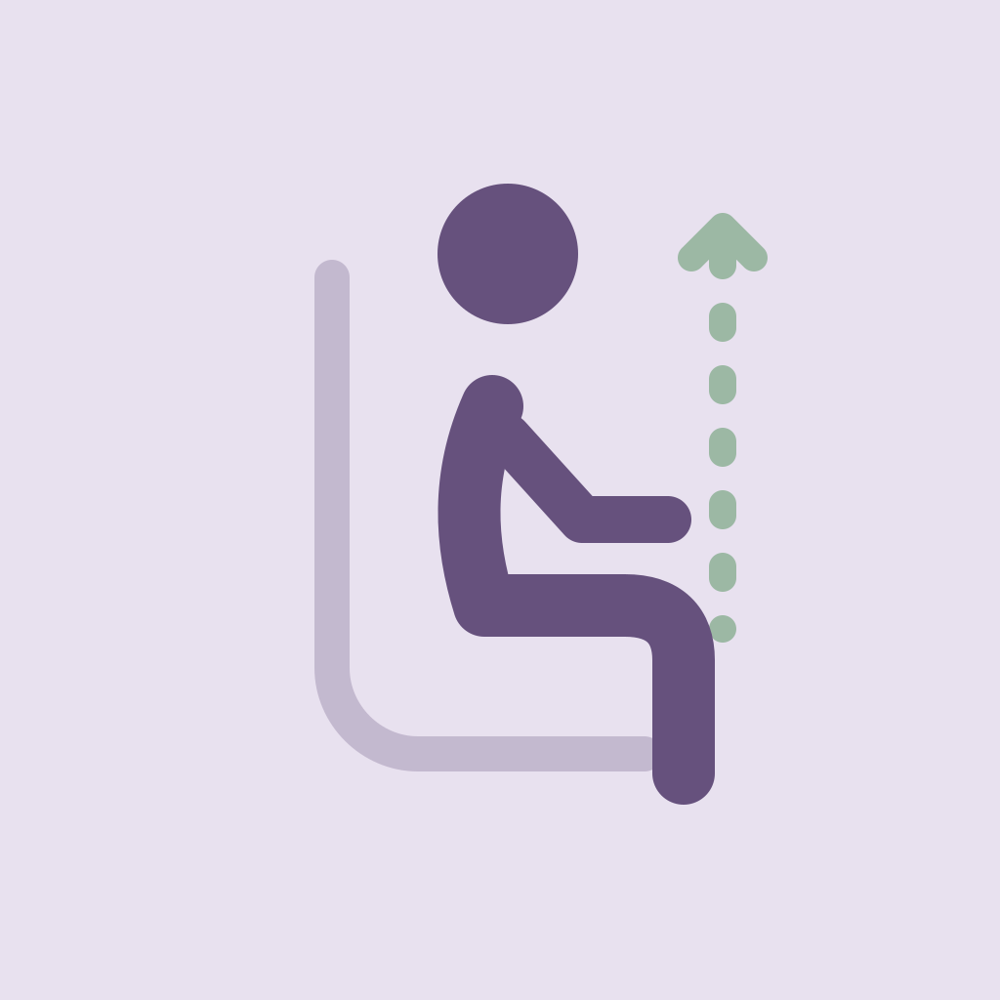

# PosturePal logo

An upright seated figure and alignment guide represent posture feedback.

- **logo.svg**: editable vector master with outlined shapes and no external fonts.
- **app-icon-1024.png**: opaque 1024 × 1024 app icon.
- **app-icon-256.png**: smaller copy for web use.

Keep the square image for platform use; apply rounded corners in the interface. Use the SVG for resizing or recoloring.
