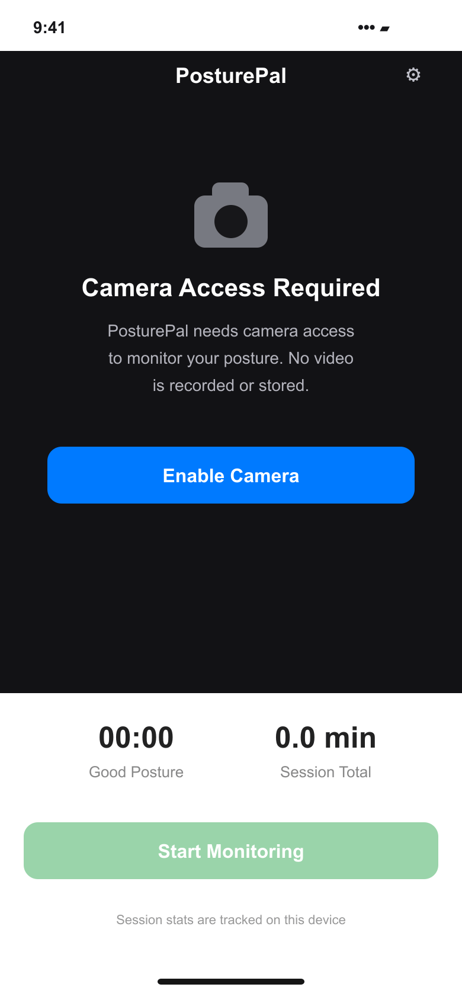
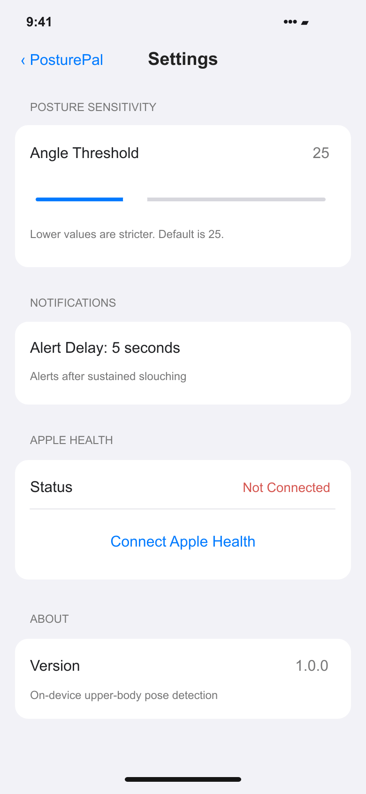

# Portfolio screens

Prepared for the Davin Cuaso portfolio on 6 November 2026.

These are source-based interface recreations with fictional sample data. They are not screenshots from a running native app or backend. Camera scenes and ingredient illustrations are schematic; measurements, saved places, and study statistics are sample content.

The SVG files are editable masters; PNG files are opaque exports.

## Camera permission and monitoring

Source: [PosturePal/Views/ContentView.swift](https://github.com/davincuaso/PosturePal/blob/cac03dee57918d151b79d637443d05cfb65fd65f/PosturePal/Views/ContentView.swift).

## Sensitivity and notifications

Source: [PosturePal/Views/SettingsView.swift](https://github.com/davincuaso/PosturePal/blob/cac03dee57918d151b79d637443d05cfb65fd65f/PosturePal/Views/SettingsView.swift).

